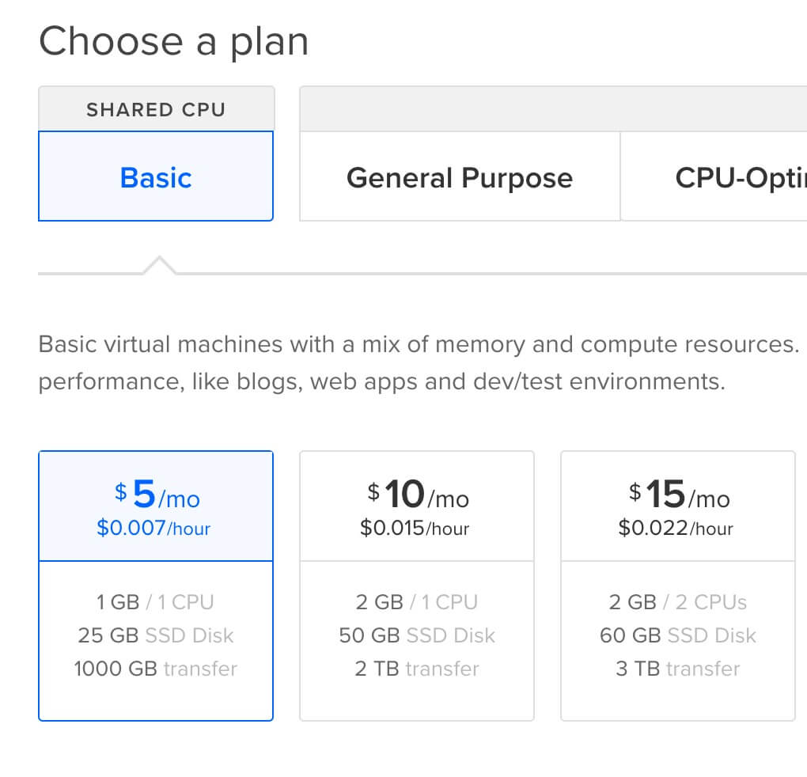
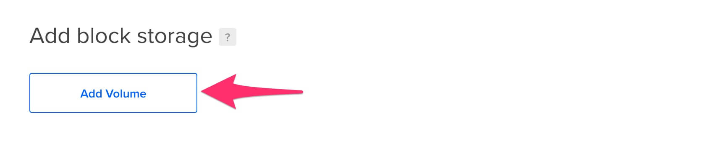
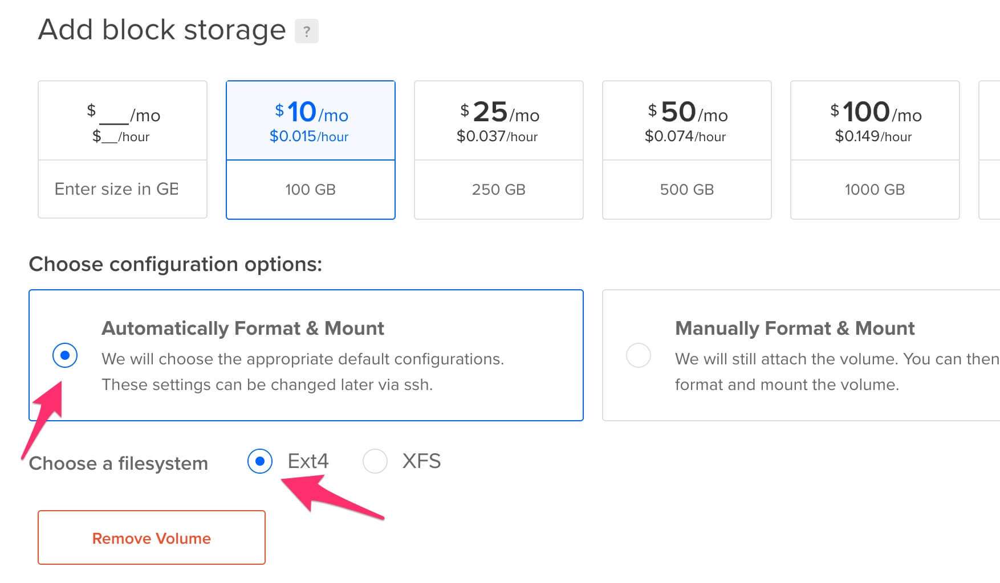
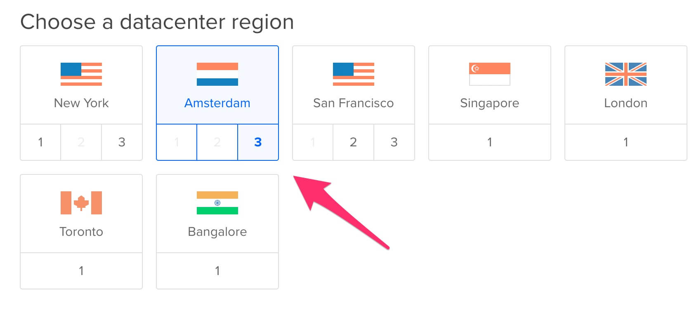
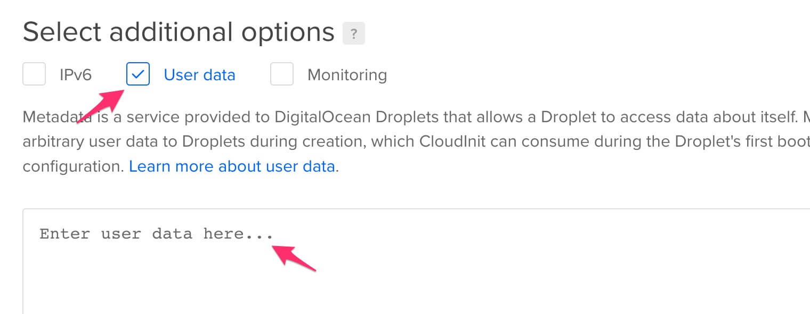
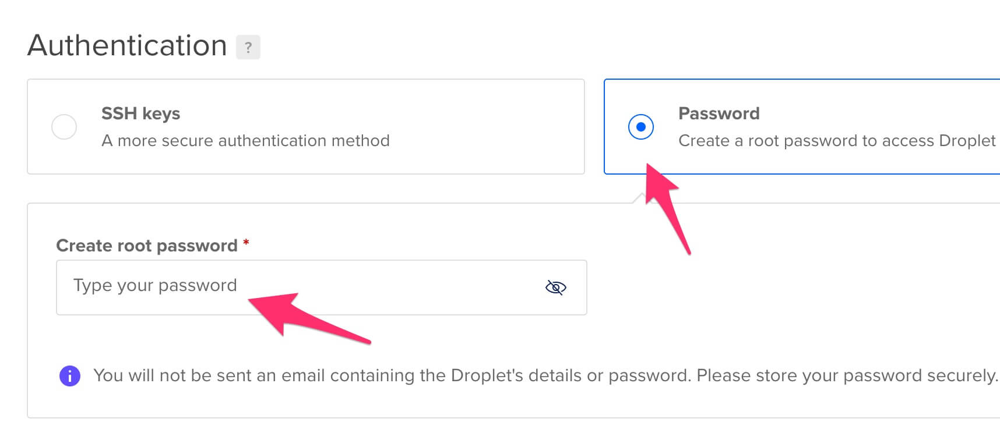
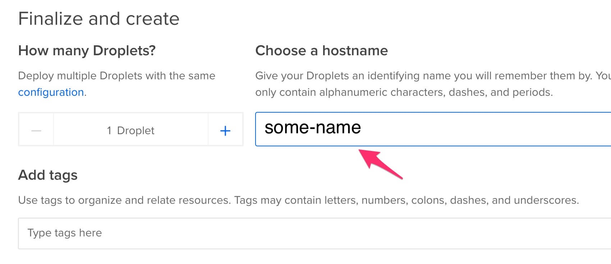
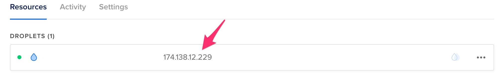

How to Deploy Fluxomni Studio to DigitalOcean
=======================================

This guide shows the recommended setup for Fluxomni Studio on one [DigitalOcean] droplet.

## 0. Prerequisites

You need a [DigitalOcean] account with a [payment method][1].

## 1. Create Droplet

Open the [droplet creation page][2].

### 1.1. Choose an Image

Select **Ubuntu 24.04 LTS**.

Supported platforms:

- Linux x64 / ARM64
- macOS x64 / Apple Silicon
- Windows (WSL2 Ubuntu)

### 1.2. Choose a Plan

The cheapest plan should be enough for simple restreaming. Choose a more powerful plan for many streams or transcoding.



### 1.3. Add Volume (Optional)

> __NOTE__: Skip this step if you do not plan to record streams to files.

Recording live streams may need more disk space than the default disk provides. You can attach an external block storage volume to the droplet.




The installer will automatically detect and use the attached volume for Fluxomni Studio.

### 1.4. Choose a Datacenter Region

Choose a region near both your stream source and destinations to reduce latency.



### 1.5. Add User Data

To automatically install Fluxomni Studio on the new droplet, paste the following script into the `User data` field. The script runs once when the droplet is created. It also configures a firewall with the required ports.

```bash
#!/bin/bash
curl -fsSL https://install.fluxomni.io | WITH_UFW=1 bash -s
```



### 1.6. Select Authentication Method

[DigitalOcean] requires an authentication method to access the droplet. You can use an [SSH] key (recommended) or set a root password. These credentials are for server management. You do not need them to use Fluxomni Studio.



### 1.7. Finalize and Create

Choose a hostname for your droplet to easily identify it later. You can leave the other settings at their defaults.



Click **Create Droplet** to begin provisioning.

## 2. Access Fluxomni Studio

After you create the droplet, wait 5-15 minutes for server setup and installation.

You can find the IP address of your droplet in the DigitalOcean control panel.



Open the droplet's IP address in your browser.


Current releases serve the operator UI from the `frontend` container.
Use `/routes` for route management and `/fleet` to inspect attached media nodes.

> __NOTE__: Fluxomni Studio uses `http://` by default. For production, we strongly recommend a domain name and a reverse proxy, such as Nginx or Caddy, to provide secure access over `https://`.

Next, complete [First Stream](../getting-started/first-stream.md) to create a protected operator account and verify one live route.

[DigitalOcean]: https://digitalocean.com
[SSH]: https://en.wikipedia.org/wiki/SSH_(Secure_Shell)

[1]: https://cloud.digitalocean.com/account/billing
[2]: https://cloud.digitalocean.com/droplets/new
