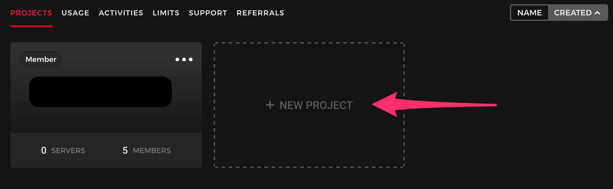
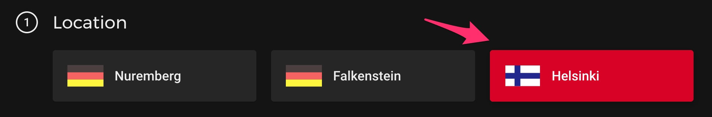
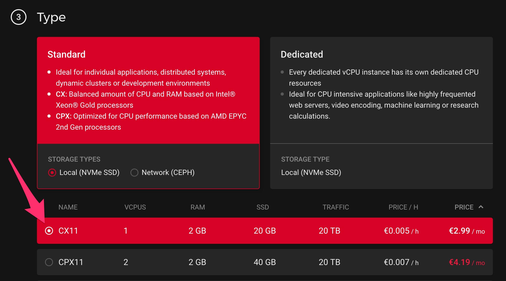
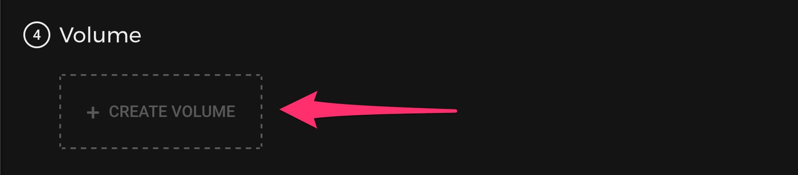
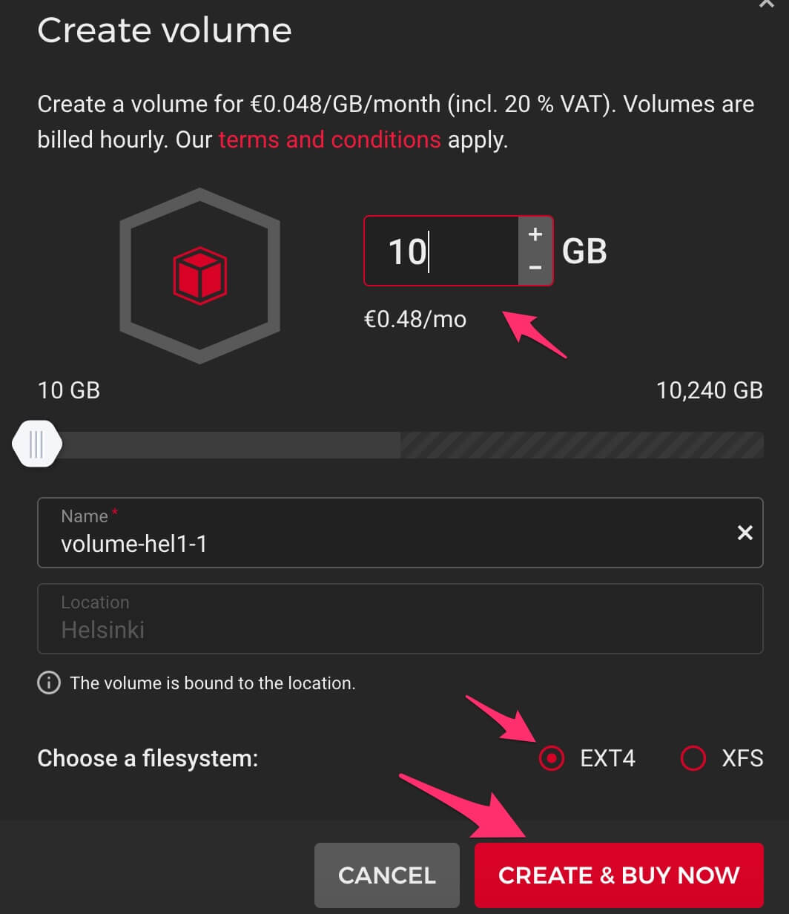
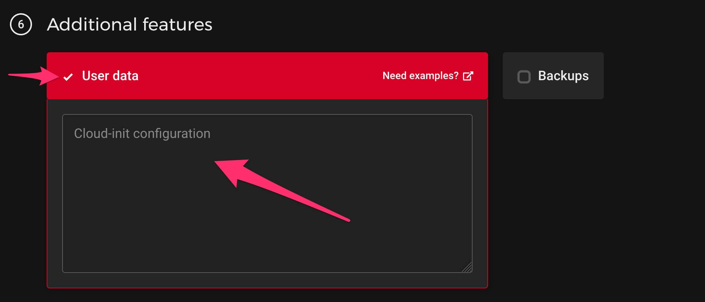
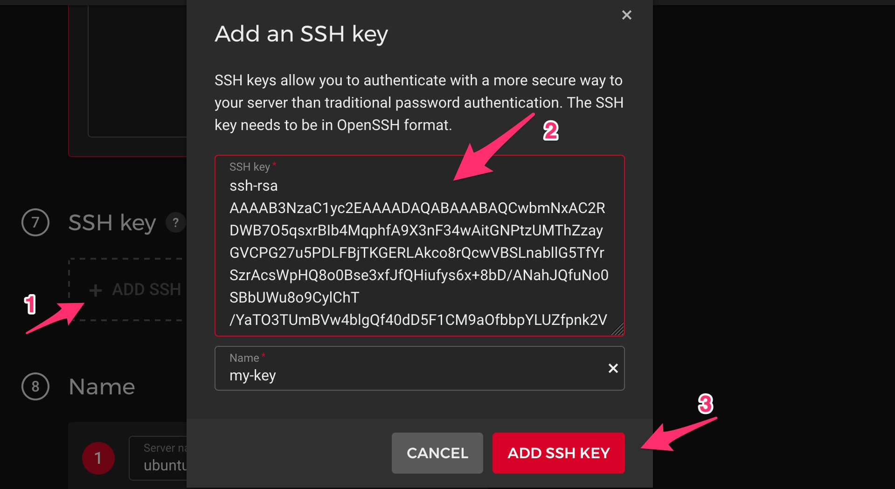
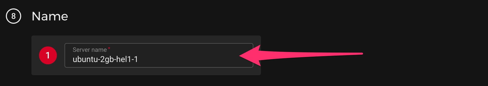
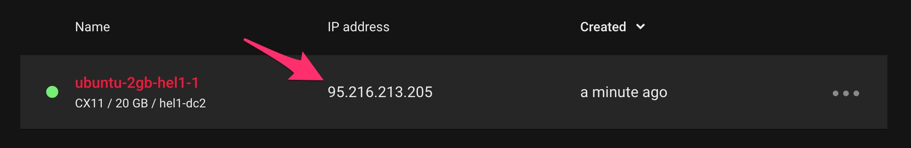
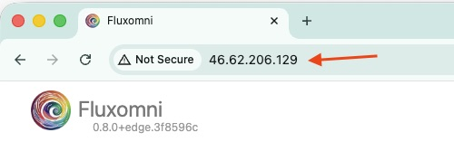

How to Deploy Fluxomni Studio to Hetzner Cloud
=========================================

This guide shows the recommended setup for Fluxomni Studio on one [Hetzner Cloud] server.

## 0. Prerequisites

You need a [Hetzner Cloud] account with a [payment method][1] and a [Project].



## 1. Create Server

From your project dashboard, click to create a new server.

### 1.1. Choose a Location

Choose a location near both your stream source and destinations to reduce latency.



### 1.2. Choose an Image

Select **Ubuntu 24.04**.

Supported platforms:

- Linux x64 / ARM64
- macOS x64 / Apple Silicon
- Windows (WSL2 Ubuntu)

### 1.3. Choose a Type

The cheapest plan, such as `CX11`, should be enough for simple restreaming. Choose a more powerful server for many streams or transcoding.



### 1.4. Add Volume (Optional)

> __NOTE__: Skip this step if you do not plan to record streams to files.

Recording live streams may need more disk space than the default disk provides. You can attach an external volume to the server.




The installer will automatically detect and use the attached volume for Fluxomni Studio.

### 1.5. Add User Data

To automatically install Fluxomni Studio on the new server, paste the following script into the `User data` field. The script runs once when the server is created. It also configures a firewall with the required ports.

```bash
#!/bin/bash
curl -fsSL https://install.fluxomni.io | WITH_UFW=1 bash -s
```



### 1.6. Add an SSH Key

[Hetzner Cloud] requires an [SSH] key to access the server. The key is for server management. You do not need it to use Fluxomni Studio.



### 1.7. Finalize and Create

Choose a name for your server to easily identify it later. You can leave the other settings at their defaults.



Click **Create & Buy Now** to begin provisioning.

## 2. Access Fluxomni Studio

After you create the server, wait 5-15 minutes for server setup and installation.

You can find the IP address of your server in the Hetzner Cloud console.



Open the server's IP address in your browser.



Current releases serve the operator UI from the `frontend` container.
Use `/routes` for route management and `/fleet` to inspect attached media nodes.

> __NOTE__: Fluxomni Studio uses `http://` by default. For production, we strongly recommend a domain name and a reverse proxy, such as Nginx or Caddy, to provide secure access over `https://`.

Next, complete [First Stream](../getting-started/first-stream.md) to create a protected operator account and verify one live route.

[Hetzner Cloud]: https://hetzner.com/cloud
[Project]: https://console.hetzner.cloud/projects
[SSH]: https://en.wikipedia.org/wiki/SSH_(Secure_Shell)

[1]: https://accounts.hetzner.com/account/payment
