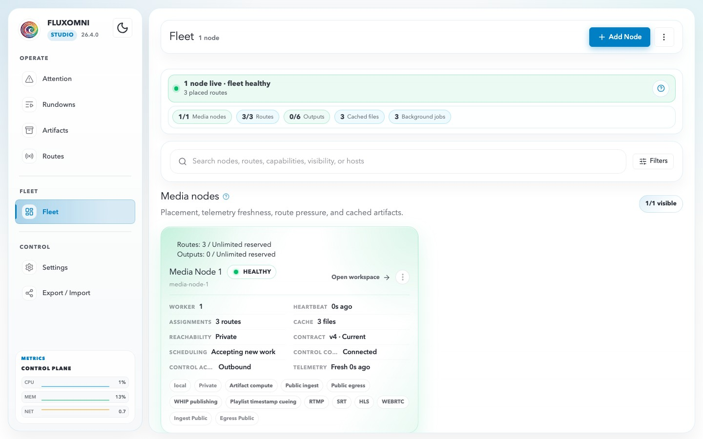
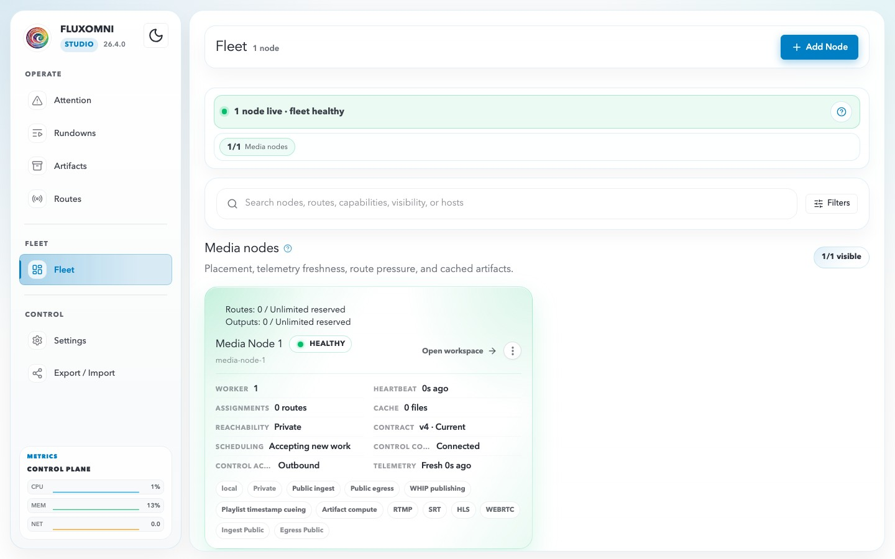
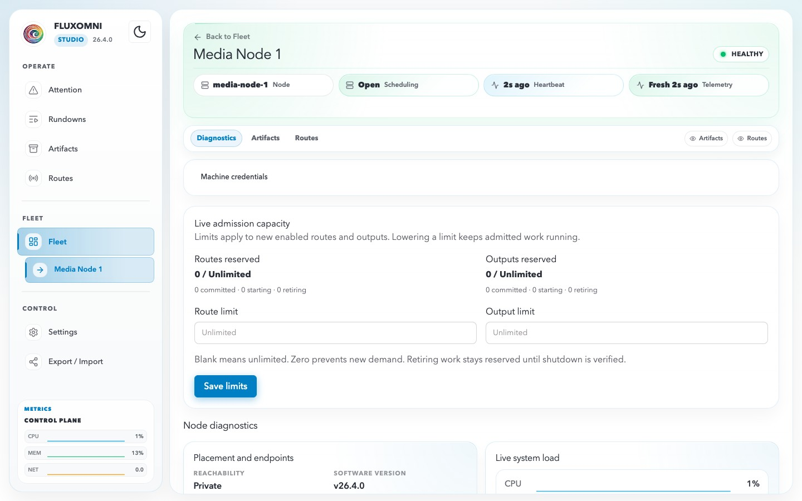
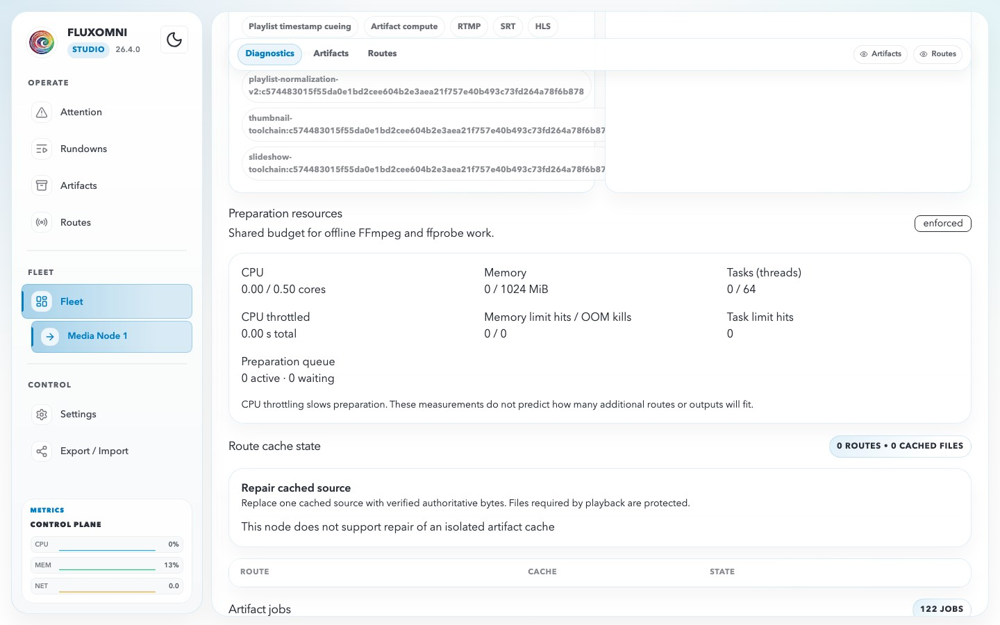
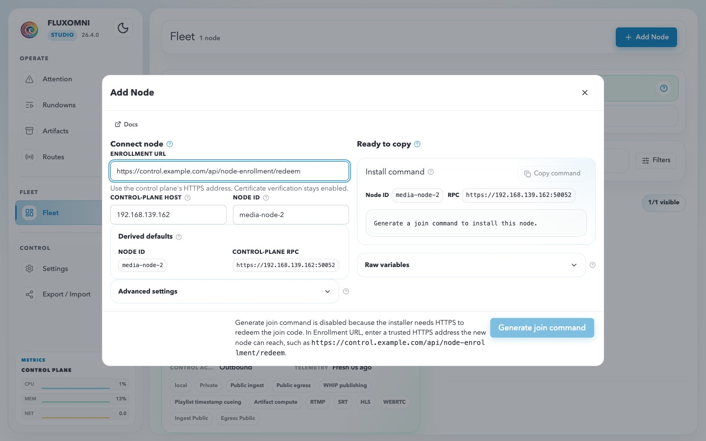

# Fleet

The Fleet page (`/fleet`) lists all media nodes attached to your Fluxomni instance. Use it to check node health, capacity, and cached artifacts.

## Fleet Overview

The top of the Fleet page shows a summary bar with:

- **Media nodes** — total attached nodes and how many are healthy (e.g. 1/1).
- **Assigned routes** — how many routes are placed on nodes.
- **Cached files** — total artifact files currently cached across the fleet.

Click **+ Add Node** to register a new media node (see the [Quick Start](../getting-started/quick-start.md#attach-another-media-node) guide for the installation command).

## Fleet Tabs

### Controls

The default view with a search bar and filters. You can search by node name, route, capabilities, visibility, or host. The main panel shows each media node as a card with live telemetry.

### Nodes

A focused list of all registered nodes.

### Artifacts

Shows where artifacts required by assigned routes are cached. Use the separate [Artifacts page](artifacts.md) to upload, import, tag, delete, or inspect library storage.

## Media Node Card

Each media node card displays:

| Field | Description |
| ------- | ------------- |
| **Node name** | Human-readable name (e.g. "Media Node 1") |
| **Node ID** | Machine identifier (e.g. "media-node-1") |
| **Node Health** | Current health status: Healthy, Degraded, or Offline |
| **Worker** | Number of active worker processes |
| **Assignments** | Number of routes placed on this node |
| **Heartbeat** | Time since last heartbeat (e.g. "2s ago") |
| **Reachability** | Network visibility: Public or Private |
| **Control Plane** | Access mode: Operator-only or Full |
| **Cache** | Number of cached artifacts on the node |
| **Scheduling** | Whether the node is accepting new work |
| **Telemetry** | Freshness of telemetry data |

### Capabilities

Each node advertises its supported protocols and features as tags:

- **Protocols**: RTMP, SRT, HLS, WEBRTC
- **Visibility**: Public, local
- **Functions**: Artifact compute, Public ingest, Public egress, Ingest Public, Egress Public

### Routes

Below the capabilities, you can see which routes are currently placed on this node.

## File Distribution (Artifacts)

The Fleet **Artifacts** section shows node caches. Use it to check whether the artifacts required by a route are on its assigned node. To edit the shared library, use the separate Artifacts page.

- **Cached artifacts** — total files cached across all nodes.
- **Nodes with gaps** — nodes that are missing files required by their assigned routes.
- **Blocked routes** — routes that cannot start because required files are not cached on the assigned node.

The distribution table lists required, cached, and missing files for each node and route, with an overall status (Applied, Pending, etc.).

If a row shows a baseline compatibility status such as **Compatible**, **Incompatible**, or **Unknown**, the exact preset definitions are in [Settings → Media profiles](settings.md#media-profiles). Fleet shows whether required files are present on nodes; profile definitions explain why a file may or may not match the route's expected media properties.

For library operations, use:

- [Artifacts](artifacts.md) — upload files, import from Drive, tag assets, inspect storage, and reuse files in playlists or file-backup sources.
- [Settings → Artifacts](settings.md#artifacts) — configure Google Drive imports and shared file-operation limits.
- [Settings → Media profiles](settings.md#media-profiles) — review the baseline presets used by route, playlist, and artifact compatibility checks.

## Opening a Node

Click **Open node →** on any media node card to view detailed node information, including full telemetry, route assignments, and cached file inventory. Use [Attention](attention.md) to review node issues that need action, then return to node diagnostics.

## Control connection

Each node reports **Control connection** separately from media reachability. A private node can show a control connection without exposing an inbound control port.

## Admission ceilings

Open a node to set **Route limit** and **Output limit**. Blank means unlimited. Zero prevents new demand. The same panel shows routes and outputs already reserved, including work that is starting or retiring. **Save limits** writes the ceilings. The still shows the form and does not save.

## Preparation resources

The node page includes **Preparation resources** when the node reports them: CPU, memory, tasks, and the preparation queue, including waiting work. The figures describe offline preparation. They do not predict how many additional routes or outputs will fit. The capture does not start a preparation job.

## Add a private node

**Add Node** opens the enrollment form. Set **Enrollment URL** to the control plane HTTPS address the new node can reach. **Generate join command** creates a one-time code and a copy-and-run installer command. The still is taken before that button is used. Commands, one-time codes, private keys, and private hosts are masked in the capture. Follow [Attach Another Media Node](../getting-started/quick-start.md#attach-another-media-node) for the install itself.

