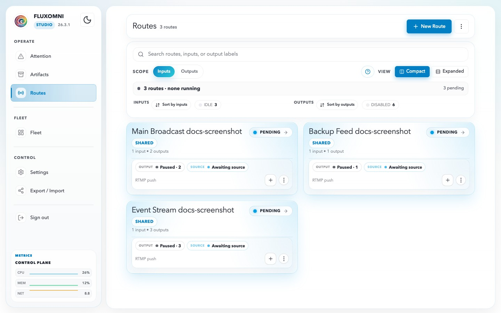

# User Guide

Use the **Control Surface** in your browser to operate Fluxomni Studio. Check route health, see which source is on air, and manage outputs, playlists, media nodes, and local users.

This guide covers daily use of the Control Surface after you install Fluxomni Studio. For installation and deployment, see the [Quick Start](../getting-started/quick-start.md) section.

## Key Concepts

**Route** — a named streaming configuration that connects sources to destinations. Open its workspace to manage sources, outputs, playlists, and playback. The active source can be live media, a playlist, or a file fallback.

**Input** — the endpoint that receives your source stream. Fluxomni Studio generates a unique URL for each route depending on the chosen protocol (RTMP, SRT, or WebRTC). Point your encoder (OBS, FFmpeg, hardware encoder) at this URL.

**Output** — a destination where Fluxomni Studio sends the incoming stream. Outputs are typically RTMP URLs for platforms like YouTube, Twitch, Facebook Live, or custom CDN endpoints.

**Media Node** — a server that processes media (transcoding, relaying, file playback). A single-host install runs one media node automatically. Larger deployments can attach multiple media nodes across different servers.

**Fleet** — the view of all attached media nodes, their health, capacity, and cached files.

**Playlist** — a queue of pre-recorded video files that a route can play out through its outputs, useful for scheduled programming or fallback content.

**Artifact** — a reusable source file or generated media asset tracked in the shared library. Artifacts can be uploaded once, tagged, monitored for storage usage, and reused from playlists or file-backup sources.

## Control Surface Layout

The Control Surface has a sidebar on the left. It shows the Fluxomni Studio logo, version badge, theme toggle, navigation menu, sign-out action, and live system metrics. The area on the right shows the current page.

### Operate

- **Attention** — one feed for route alerts, fleet alerts, and known issues. Each route alert links directly to the affected workspace.
- **Routes** — the main page for streams. It includes search, scope controls, health summaries, route cards, and output actions.
- **Artifacts** — the shared source-file library. Upload files, import from Drive, add tags, check storage limits, and reuse files in playlists.

### Fleet

- **Fleet** — a list of all media nodes. Check node health, assignments, heartbeat age, reachability, capabilities, and cached files.

### Control

- **Settings** — settings available to your role. Manage general defaults, artifact imports, media profiles, session security, and users.
- **Export / Import** — bulk export or import of route configurations.

### System Metrics

The bottom of the sidebar shows real-time CPU, memory, and network usage for the control plane.

## Next Steps

- [Attention](attention.md) — review route, fleet, and storage alerts
- [Routes](routes.md) — learn how to create and operate routes
- [Artifacts](artifacts.md) — upload and reuse source files across routes
- [Fleet](fleet.md) — understand media node management
- [Settings](settings.md) — configure your Fluxomni Studio instance
- [Export / Import](export-import.md) — move or restore route definitions
