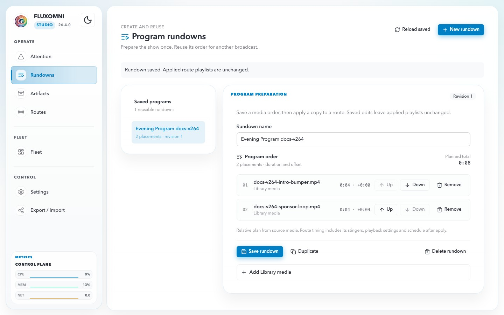
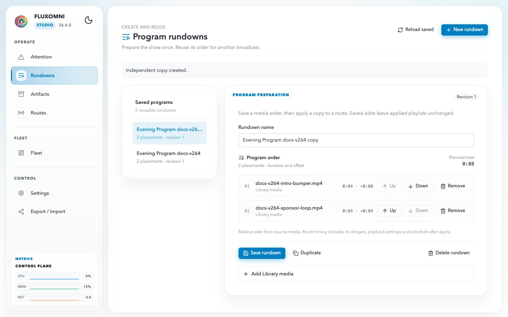
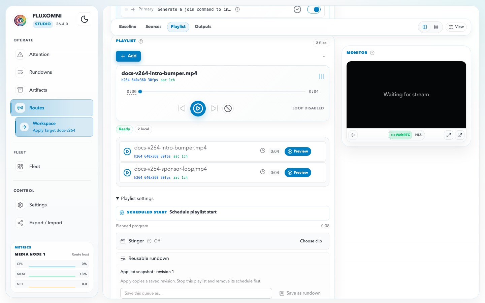

# Rundowns

A rundown is a saved program order. Open **Rundowns** in the sidebar of the Fluxomni web app, or visit `/rundowns`, to create one and reuse it on an idle route.

## Create and save

This video creates a rundown, adds Library media, saves it, and duplicates the saved revision.

<video controls muted playsinline width="100%">
  <source src="../videos/user-guide/rundowns.webm" type="video/webm">
</video>

1. Click **New rundown**.
2. Enter a **Rundown name**.
3. Open **Add Library media** and select files. The same clip can be placed more than once.
4. Review **Program order** and the **Planned total**.
5. Click **Save rundown**.

The editor shows **Unsaved** while the draft differs from the saved revision. **Reload saved** restores the last saved revision. Saving does not change a route that already applied an older copy.

Library files used by a saved rundown stay protected from ordinary deletion until that use is removed.

## Duplicate

**Duplicate** saves an independent copy. The copy name adds “ copy” to the original name. Routes that already applied the original keep that revision.

Deleting a saved rundown leaves those applied route copies in place.

## Apply to an idle route

Apply from the route, not from the rundown editor. Open an idle route that has no playlist schedule, switch to **Playlist Playout**, and open **Playlist settings**. Under **Reusable rundown**, choose the saved rundown and click **Apply rundown**.

The route must be idle, and its playlist must not have a schedule. Apply copies that exact saved revision into the route playlist.

Later edits to the saved rundown do not change the route until you apply again. See [Playlist programming](routes.md#playlist-programming) for timing, stingers, and schedules on the route itself.
