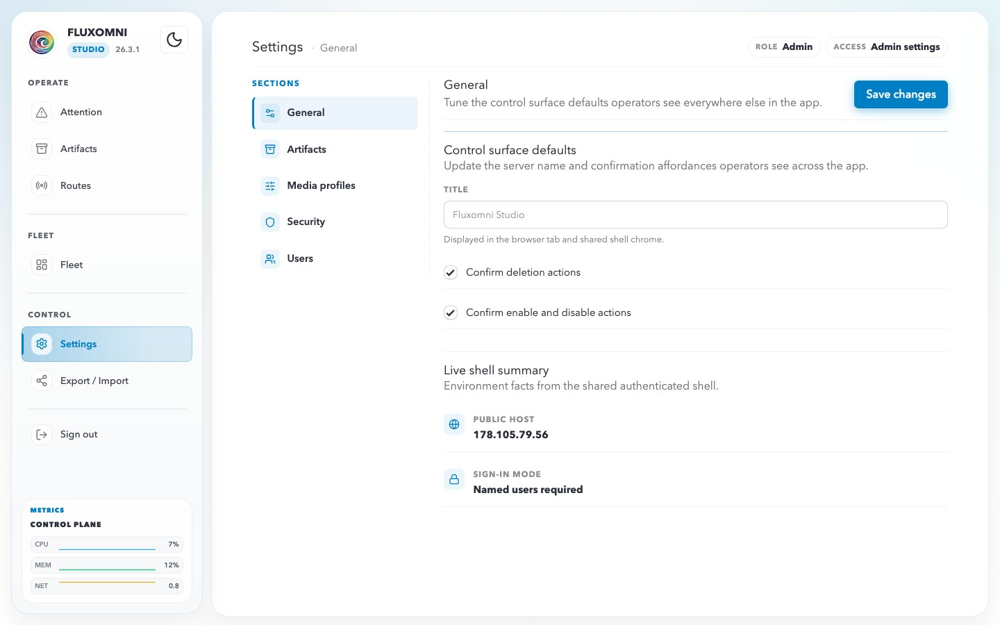
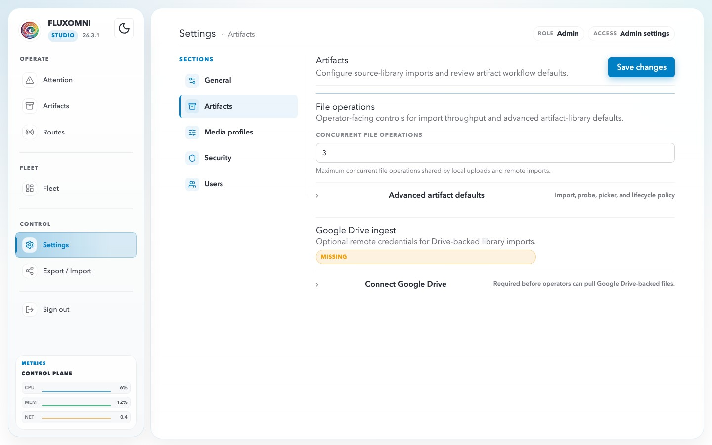
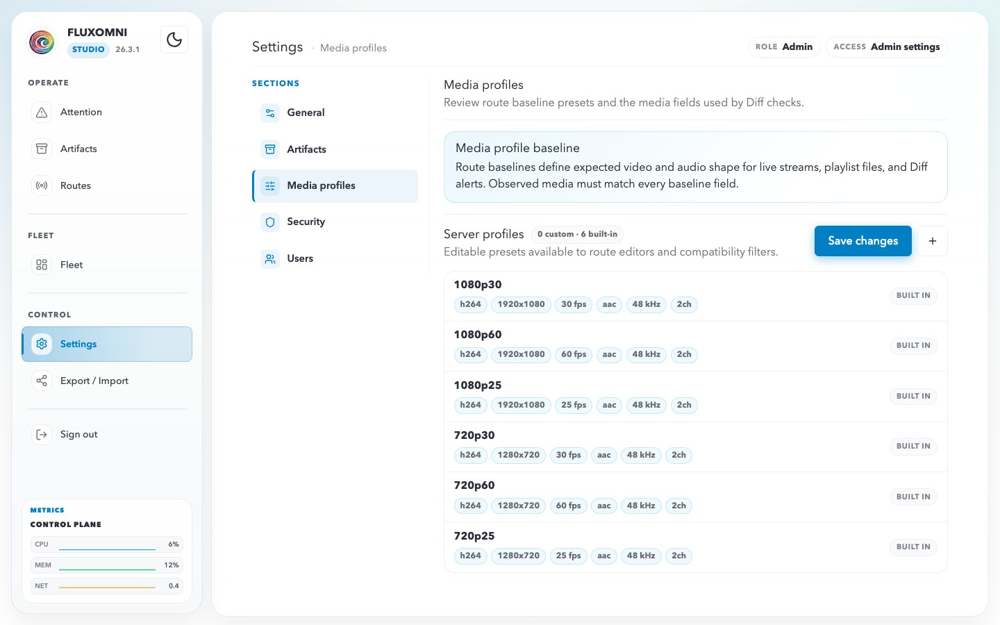
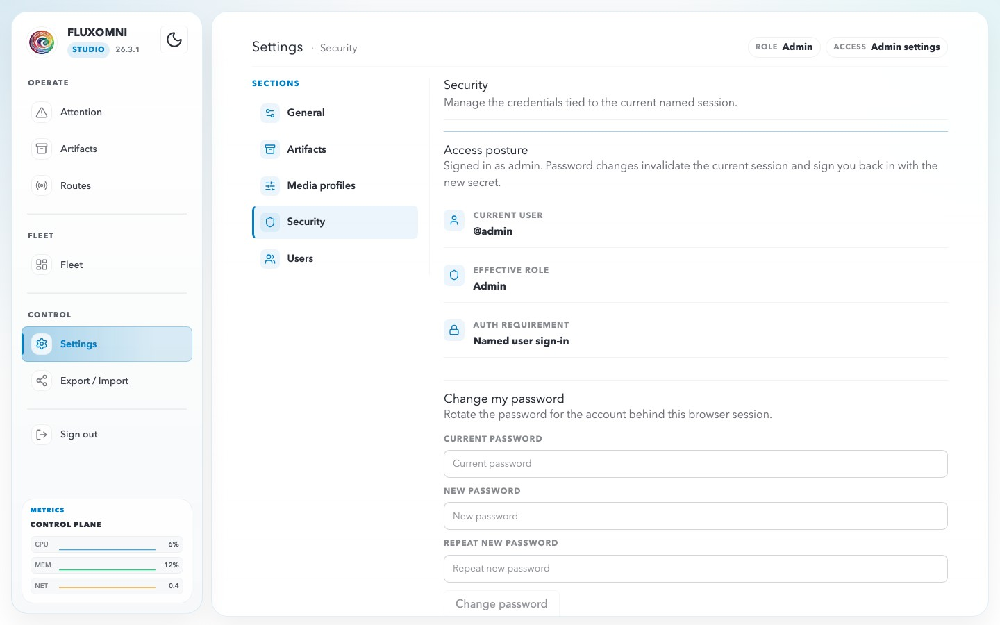
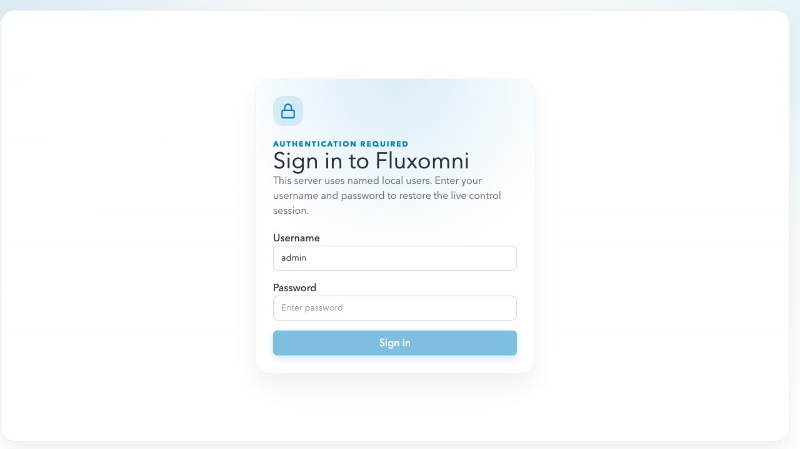
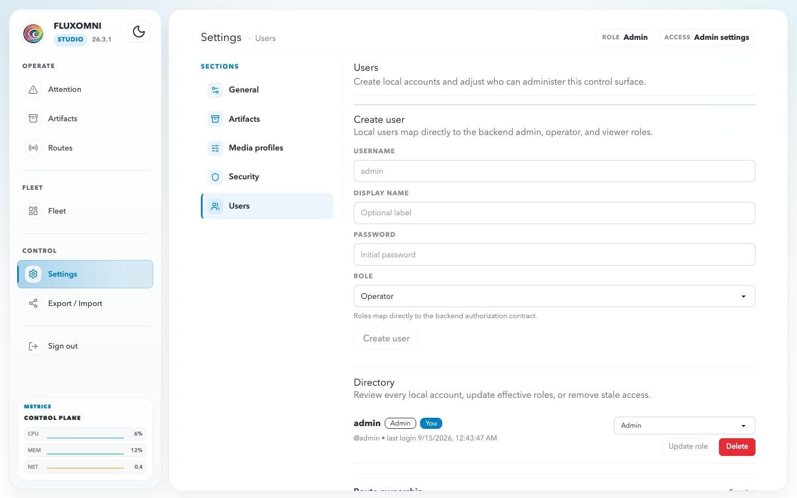

# Settings

Use Settings (`/settings`) to manage server defaults, artifact imports, media profiles, your account, and local users. Open **Settings** in the sidebar.

The page uses a split layout:

- a **section list** on the left
- a **summary card** at the top showing your current **Role** and **Access** level
- a large **content panel** for the selected section on the right

Admins can open **General**, **Artifacts**, **Media profiles**, **Security**, and **Users**. Operators can only open the self-service **General** and **Security** sections.

## General

The **General** section contains Control Surface defaults and a read-only summary of the current interface settings. Admins can edit shared defaults. Operators can view this section as a reference.

### Control surface defaults

These settings apply to the shared interface:

- **Title** — the server name shown in the browser tab and shared interface.
- **Confirm deletion actions** — requires confirmation before destructive actions such as deleting routes, outputs, or files.
- **Confirm enable and disable actions** — adds confirmation before toggling inputs or outputs on or off.

### Live shell summary

The lower summary cards show the current interface settings:

- **Public host**
- **Delete confirmation**
- **Enable confirmation**
- **Sign-in mode**

## Artifacts

The **Artifacts** settings section is admin-only and controls ingest defaults for the shared media library. Use the separate [Artifacts page](artifacts.md) for day-to-day uploads, imports, tags, storage review, and playlist reuse.

### Google Drive

Google Drive settings control imports into the artifact library and route playlists:

- **Google API Key** — required before operators can import shared Drive files or folders.
- **Files Limit** — maximum concurrent file operations for local uploads and remote imports.

#### Get an API key

Fluxomni Studio uses a Google Drive **API key**, not an OAuth user token. The key lets the control plane list and download files that are already shared with link access.

To create one:

1. Open the official Google Workspace credential guide: [Create access credentials](https://developers.google.com/workspace/guides/create-credentials#api-key).
2. In Google Cloud Console, create or select a project.
3. Open **APIs & Services → Library**, search for **Google Drive API**, and enable it for the project.
4. Open **APIs & Services → Credentials** and choose **Create credentials → API key**.
5. Copy the generated key into **Settings → Artifacts → Google Drive → Google API Key** in Fluxomni Studio.
6. Recommended: restrict the key to the **Google Drive API** in Google Cloud Console. If your deployment has a stable public egress IP, also restrict usage to that IP.

Drive files and folders must be shared so the key can read them. Use link sharing such as **Anyone with the link can view** for the folders/files you import. Private files that require a signed-in Google account are not available through this API-key flow.

### Artifact workflow defaults

The remaining cards describe how artifacts work. You cannot edit these cards:

- library uploads and Drive imports are added to the shared artifact catalog
- route playlists and file-backup sources reuse the same library picker
- storage limits and rejections are shown on the Artifacts page and in the Attention feed
- media nodes cache artifacts for playback; the control plane manages the persistent catalog

## Media Profiles

The **Media profiles** settings section is admin-only and lists the baseline presets Fluxomni Studio uses when checking route playlist compatibility.

Profiles define the video and audio properties a route expects. Fluxomni Studio checks them before playlist playback and during health checks. They do not control the encoder. The current presets use H.264 video and AAC stereo audio at 48 kHz:

- `1080p30`
- `1080p60`
- `1080p25`
- `720p30`
- `720p60`
- `720p25`

Each row shows the fields Fluxomni Studio compares:

- video codec
- width and height
- frame rate
- audio codec
- audio sample rate
- audio channel count

Use this section when a route, playlist item, or artifact row shows a **Compatible**, **Incompatible**, or **Unknown** baseline status. Route workspaces and artifact pickers show a short status. Settings → Media profiles shows the exact properties used for these checks.

## Security

The **Security** section shows authentication settings for the current browser session.

### Access posture

The top card shows how this session is authenticated:

- **Current user** — the signed-in username, or the open admin shell when auth is disabled.
- **Effective role** — the resolved role for the current session.
- **Auth requirement** — whether the server is running in **Named user sign-in** mode or **Open shell** mode.

### Change my password

When you are signed in as a named local user, use the password form to change that account's password. Fluxomni Studio invalidates the current session and signs the browser back in with the new password once the change succeeds.

### Sign-in screen

When named-user auth is required, browsers without a valid session show the sign-in screen shown below.

Creating the first saved admin user enables named-user sign-in on a new open-shell install.

## Users

The **Users** section is admin-only and manages local accounts plus route ownership.

### Create user

Use the creation card to add a local account:

- **Username** — login name for the operator
- **Display Name** — optional friendly label
- **Password** — initial password
- **Role** — Admin, Operator, or Viewer

On a new open-shell install, the first saved user always becomes an **Admin**. Creating this account immediately enables named-user authentication.

### Directory

The Directory card lists all local accounts with their:

- display name or username
- role badge
- last login timestamp
- controls to **Update role** or **Delete** the user

Changing your own role or deleting your own account reloads the interface with the new access permissions.

### Route ownership

Fluxomni Studio routes can be either **Shared** or owned by a single named user.

- **Shared routes** remain visible to every signed-in user.
- **Owned routes** are visible only to their assigned user and admins.
- Admins can assign or clear ownership from the route modal and from the route-ownership panels in **Users**.
- If a user is deleted, their routes become shared.

The Users page has a **Route ownership** panel for each user and a **Shared routes** section for assigning unowned routes.

### User roles

Fluxomni Studio has three built-in roles:

| Role | Access |
| ---- | ------ |
| **Admin** | Full access to routes, fleet, settings, user management, export/import, and ownership assignment. |
| **Operator** | Can create and manage routes, playlists, and outputs for routes they can see. Operators only get self-service Settings sections. |
| **Viewer** | Read-only access to visible routes and system surfaces. |

## Export / Import

Use the **Export / Import** action in the sidebar to open the route-definition transfer modal. See [Export & Import](export-import.md) for export scope, preview, replace-mode, owner mapping, and safe-apply guidance.
